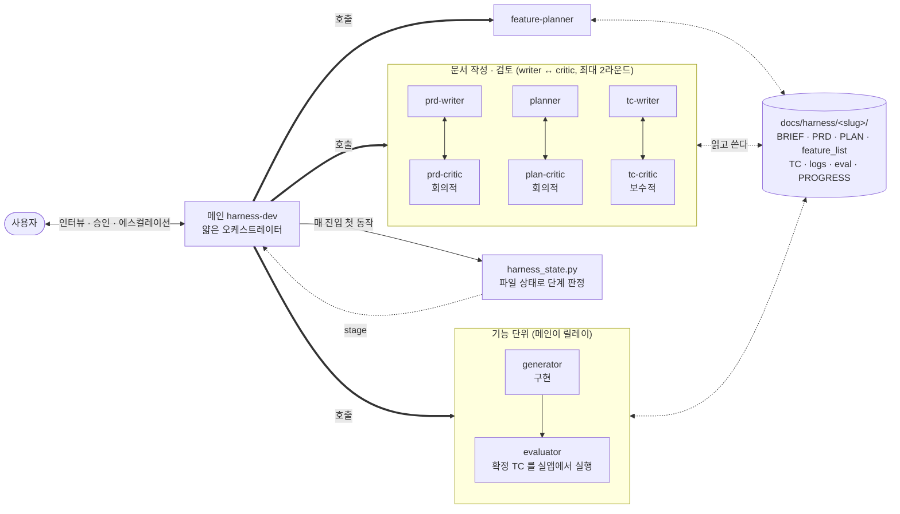
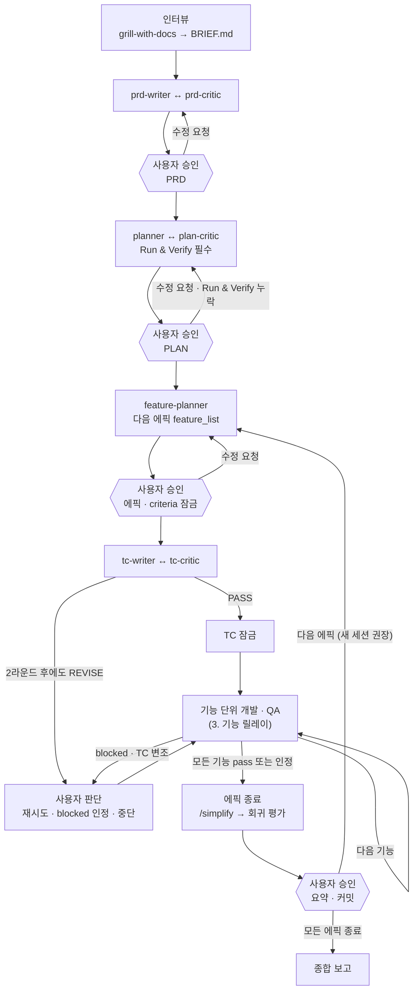
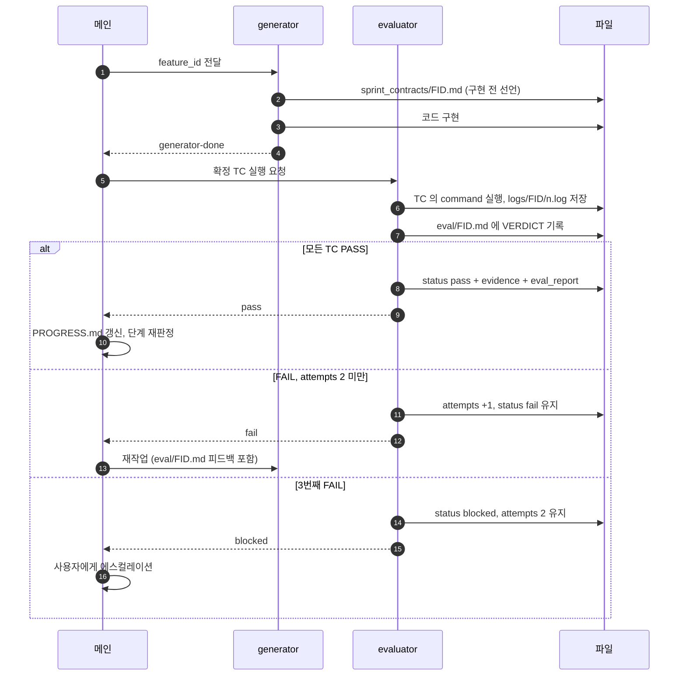

# harness-devkit

제품 아이디어를 PRD 에서 QA 까지 단계별 서브에이전트로 끌고 가는 하네스와, dev 서버를 띄워 감시하는 도구.
스킬 2개 · 에이전트 9개 · 훅 1개. 용어는 [`CONTEXT.md`](./CONTEXT.md), 설계 근거는
[`docs/adr/0001`](./docs/adr/0001-per-stage-subagents-thin-orchestrator.md).

## 설치

```
/plugin install harness-devkit@kbk109-plugins-marketplace
```

## 선행 요건

| 요건 | 쓰는 곳 | 비고 |
|---|---|---|
| context7 MCP | dev-monitor | 기술적 사실 근거 확보 |
| WebSearch | dev-monitor | 외부 이벤트(장애·릴리즈) 근거 확보 |
| 프로젝트 `CLAUDE.md` | dev-monitor | 서버 실행 명령의 단일 소스(SSoT). 없으면 즉시 중단한다 |
| `python3` | harness-dev | 상태 판정·검증 스크립트와 훅 |
| `/mattpocock-skills:grill-with-docs` | harness-dev | 권장. 인터뷰 단계에서 호출한다. 없으면 같은 방식을 AskUserQuestion 으로 직접 수행한다 |
| Playwright MCP | harness-dev (evaluator) | 선택. PLAN 의 `e2e` 명령이 기본이고, 있으면 화면 검증에 추가로 쓴다 |

## 스킬

### `harness-dev`
아이디어 하나를 **PRD → PLAN → 에픽별 feature_list → TC → 개발 → QA** 로 끌고 간다. 메인 세션은
얇은 오케스트레이터이고, 단계마다 새 서브에이전트가 일한다 (컨텍스트 리셋). 세션이 끊겨도
`docs/harness/<slug>/` 의 파일 상태에서 다시 이어진다 — "지금 어느 단계인가" 는
`harness_state.py` 가 파일을 보고 판정한다.

| 단계 | 에이전트 | 승인 |
|---|---|---|
| 인터뷰 | (메인, `grill-with-docs`) → `BRIEF.md` | — |
| PRD | `prd-writer` ↔ `prd-critic`(회의적) 최대 2라운드 | 사용자 |
| PLAN | `planner` ↔ `plan-critic`(회의적) 최대 2라운드. Run & Verify(기동·test·E2E 명령) 필수 | 사용자 |
| 에픽 분해 | `feature-planner` → `feature_list.json` | 사용자 (잠금) |
| TC | `tc-writer` ↔ `tc-critic`(보수적) 최대 2라운드 → 잠금 | critic PASS |
| 개발·QA | `generator` → `evaluator` (기능 1개씩, 재시도 2회) | 자동, 소진 시 에스컬레이션 |
| 에픽 종료 | `/simplify` → 회귀 평가 → 요약 | 사용자 (그 뒤 커밋, push 안 함) |

QA 는 확정된 TC 를 evaluator 가 PLAN 의 실행 명령으로 **실제 앱에서** 돌린 로그만 증거로 인정한다.
`pass` 는 evaluator 만 기록할 수 있다. 사용자 승인 stage 에서 멈추고, 에픽 하나가 끝나면 새 세션을
권한다.

제약 11개 중 criteria 불변 · JSON 유지 · 재시도 상한 · status enum · 전이 · pass 기록 주체 · 증거는
아래 훅과 `validate_feature_list.py` 가 검사하고, 스텁 금지는 `--stubs` 가 잡는다. 나머지 셋은 판단
영역이라, 에픽 승인 직후 대상 프로젝트의 `AGENTS.md` 에 설치되는 **규율 블록**이 컨텍스트 압축을
견디게 한다 — 그 블록에는 진행 상태를 쓰지 않으므로 상하지 않고, 작업이 끝나도 제거하지 않는다.
되돌리려면 `harness_agents_block.py --remove`.

`docs/harness/<slug>/feature_list.json` 이 최상위에 있는 1.x 작업은 `legacy` stage 로 계속 재개된다.
기능 5개 이상의 제품 빌드에 쓴다. 단순 버그 수정·단일 파일 리팩터·질문에는 쓰지 않는다.

참고 문서 — [`docs/harness-engineering/`](../../docs/harness-engineering/)

#### 서브에이전트 관계도 · 흐름도

메인 세션(진입 스킬)은 서브에이전트를 **직접 하나씩 부르고**, 서브에이전트끼리는 서로를 부르지 못한다.
사용자와 대화하는 것도 메인뿐이다. 그래서 모든 연결이 메인을 거치고, 에이전트 사이의 전달은
`docs/harness/<slug>/` 의 파일이 맡는다. 판단의 근거와 이유는
[가이드](../../docs/guide/harness-devkit.md#2-harness-dev--단계마다-새-서브에이전트)에 있다.

**1. 관계도 — 누가 누구를 부르고, 무엇을 주고받나**



| 에이전트 | 읽는 것 | 쓰는 것 | 하지 않는 것 |
|---|---|---|---|
| `prd-writer` | `BRIEF.md`, 프로젝트 `CONTEXT.md`, 최근 critic 리뷰 | `PRD.md` (초안) | 승인 표지 변경, 구현 방법 결정 |
| `prd-critic` | `BRIEF.md`, `PRD.md` | `reviews/prd-critic-r{N}.md` | PRD 수정 |
| `planner` | 승인된 `PRD.md`, 코드베이스, 최근 critic 리뷰 | `PLAN.md` (초안, Run & Verify 포함) | 승인 표지 변경, 코드 작성 |
| `plan-critic` | `PRD.md`, `PLAN.md`, 코드베이스 | `reviews/plan-critic-r{N}.md` | PLAN 수정 |
| `feature-planner` | `PRD.md`, `PLAN.md` | 에픽의 `feature_list.json` (모두 `fail`) | 잠금 파일 생성 |
| `tc-writer` | `PRD.md`, `PLAN.md`, `feature_list.json`, 최근 critic 리뷰 | 에픽의 `TC.md` | **구현 코드 읽기**, TC 잠금 |
| `tc-critic` | `TC.md`, `feature_list.json`, `PRD.md`, `PLAN.md` | `reviews/tc-critic-r{N}.md` | **구현 코드 읽기**, TC 수정 |
| `generator` | `PROGRESS.md`, `feature_list.json`, 해당 기능의 TC, 직전 `eval/<FID>.md` | 코드, `sprint_contracts/<FID>.md`, `PROGRESS.md` 덧붙임 | **`status` 변경**, TC·criteria 수정, 커밋 |
| `evaluator` | 확정 TC, PLAN 의 Run & Verify, 계약, 구현 | `logs/<FID>/`, `eval/<FID>.md`, `feature_list.json` 의 `status`·`attempts`·`evidence` | 코드·TC 수정. **`pass` 를 기록하는 유일한 주체** |

메인이 직접 쓰는 것은 `BRIEF.md`, 승인 표지(PRD·PLAN 의 `status: approved`, `.criteria_lock.json`,
`.tc_lock.json`), `PROGRESS.md`, `CLOSED.md` 뿐이다.

**2. 단계 흐름도 — 언제 멈추고 언제 넘어가나**



- 각 critic 루프는 writer → critic → 수정을 **최대 2라운드** 돈다. 2라운드 뒤에도 REVISE 면 남은
  blocking 을 사용자에게 그대로 보여 준다 (TC 는 사람이 아니라 critic 의 PASS 가 확정한다).
- 사용자 승인 stage 에서는 항상 멈추고, 에픽 하나가 끝나면 새 세션을 권한다. 새 세션에서는
  `harness_state.py` 가 파일 상태로 같은 stage 를 다시 판정한다.

**3. 기능 릴레이 — 기능 하나가 어떻게 도나**



`pass` 는 evaluator 만 기록하고, 증거 로그가 없으면 성립하지 않는다 (훅과 검증 스크립트가 잡는다).

### `dev-monitor`
`CLAUDE.md` 에서 서버 실행 명령을 추출한 뒤, 지정한 포트의 기존 프로세스를 정리하고 서버를
백그라운드로 기동한다. 이후 로그를 실시간 감시하면서 WARNING/ERROR/CRITICAL/스택 트레이스/
HTTP 4xx·5xx 를 감지할 때마다 `[날짜, 시간]` 헤더와 함께 원인·해결책을 한국어로 분석 보고한다.

상태를 `~/.claude/dev-monitor/port-<port>.state.json` 에 외부화하므로 `/loop` 나 재호출 시
기존 Monitor·서버를 재사용하고 중복 기동을 막는다.

이 스킬은 `disable-model-invocation: true` — 자동 트리거되지 않고 명시적으로 호출해야 한다.

```
/harness-devkit:dev-monitor 3000              # 기동 + 감시
/harness-devkit:dev-monitor 3000 <log-path>   # 로그 경로 지정
/harness-devkit:dev-monitor status            # 상태 조회
/harness-devkit:dev-monitor stop 3000         # 해당 포트만 정리
/harness-devkit:dev-monitor stop-all          # 전부 정리
```

**서버 기동 명령은 `CLAUDE.md` 가 단일 소스다.** 없거나 모호하면 추측하지 않고 중단한다 —
잘못된 명령으로 서버를 띄우는 것보다 멈추는 게 낫다는 판단이다.

탐색 순서: `./CLAUDE.md` → `./.claude/CLAUDE.md` → `./docs/CLAUDE.md` → `~/.claude/CLAUDE.md`

## `feature_list.json` 규율 훅

규칙 문서만으로는 규율이 지켜지지 않는다. 긴 작업에서 컨텍스트가 압축되면 SKILL.md 의
11가지 제약이 컨텍스트에서 사라지고, `acceptance_criteria` 를 두 줄 지우면 어려운 기능이 갑자기
통과한다. 훅은 그 순간을 본다.

`PreToolUse` 로 `Write|Edit` 를 받아, 대상이 `docs/harness/**/feature_list.json`(2.0 의
`epics/<NN>/` 포함) 일 때만 결과 내용을 디스크의 이전 파일과 비교해 미리 판정하고, 제약 2·6·7·8
위반 또는 2.0 파일(`schema_version: 2`)의 제약 9(pass 기록 주체)·10(전이)·11(증거 모양) 위반이면
`deny` 한다. 호출한 에이전트는 페이로드의 `agent_type` 으로 구분한다.

**전역 배포가 안전한 이유는 세 가지다.**

**조건 미충족이면 아무것도 출력하지 않는다.** 첫 분기가 `file_path` 문자열 검사뿐이라 무관한
Write/Edit 은 파일을 열기도 전에 빠진다. harness 가 끝난 프로젝트에서도 그 파일을 다시 쓰지
않는 한 발화하지 않는다.

**전 구간 fail-open.** 예외는 통째로 삼키고 언제나 exit 0. Edit 의 치환이 애매하면(다중 매치 등)
판정하지 않고 통과시킨다 — 잘못 재현한 내용으로 멀쩡한 편집을 막는 것이 더 나쁘다.

**차단이 복구 가능하다.** 같은 `(에이전트, 위반)` 은 많아야 한 번 차단되므로 동일한 호출을 그대로
다시 하면 **반드시** 통과한다. 상태는 `{tmpdir}/harness-feature-list-gate/{에이전트 해시}.json` 에
두고, 기록에 실패하면 차단하지 않는다 — 기록 없이 차단하면 재시도도 차단되어 이 훅이 절대 만들면
안 되는 루프가 된다. 오판의 최대 대가는 도구 호출 한 번 재시도다.

키를 파일 내용이 아니라 **위반의 종류**로 잡는다. 내용 해시로 잡으면 무관한 한 글자만 바꿔도 새
키가 되어 매번 차단되고, 그게 곧 루프다.

**그래서 이 훅은 제약을 불가능하게 만들지 못한다.** 만드는 것은 조용한 지름길을 의도적인 선택으로
바꾸는 것이다. 불가능하게 만드는 쪽은 기능마다 도는 `validate_feature_list.py` 이고, 사람이
그 결과를 본다.

**비용을 알고 지불한다.** `Write|Edit` 매처는 이 플러그인이 켜진 **모든 프로젝트의 모든
Write/Edit 마다** 파이썬 프로세스를 띄운다(호출당 수십 ms). 그래서 첫 분기를 파일시스템 접근
없는 문자열 검사로 두었다.
